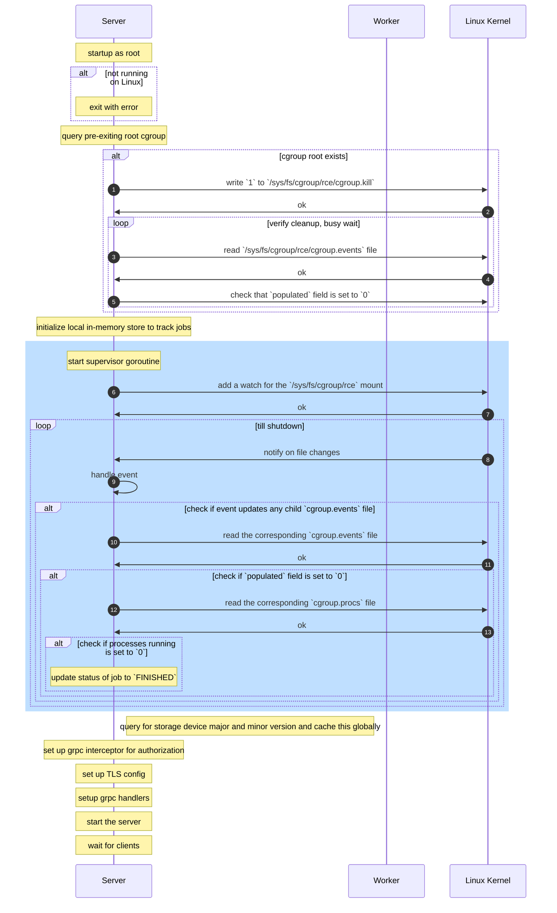
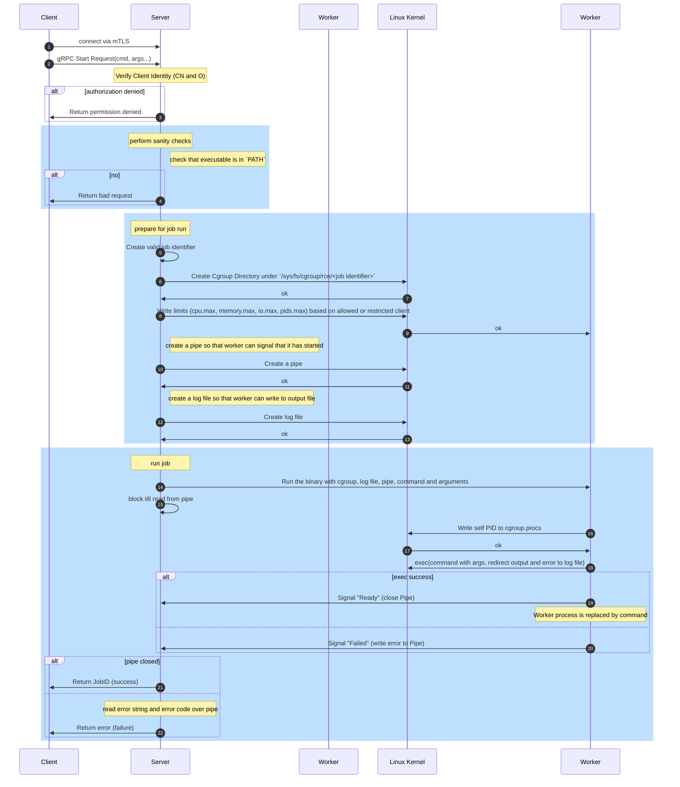
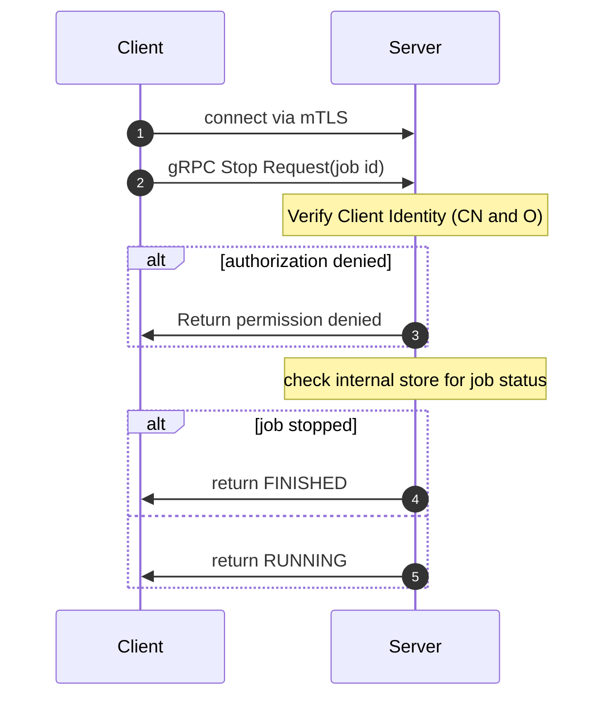
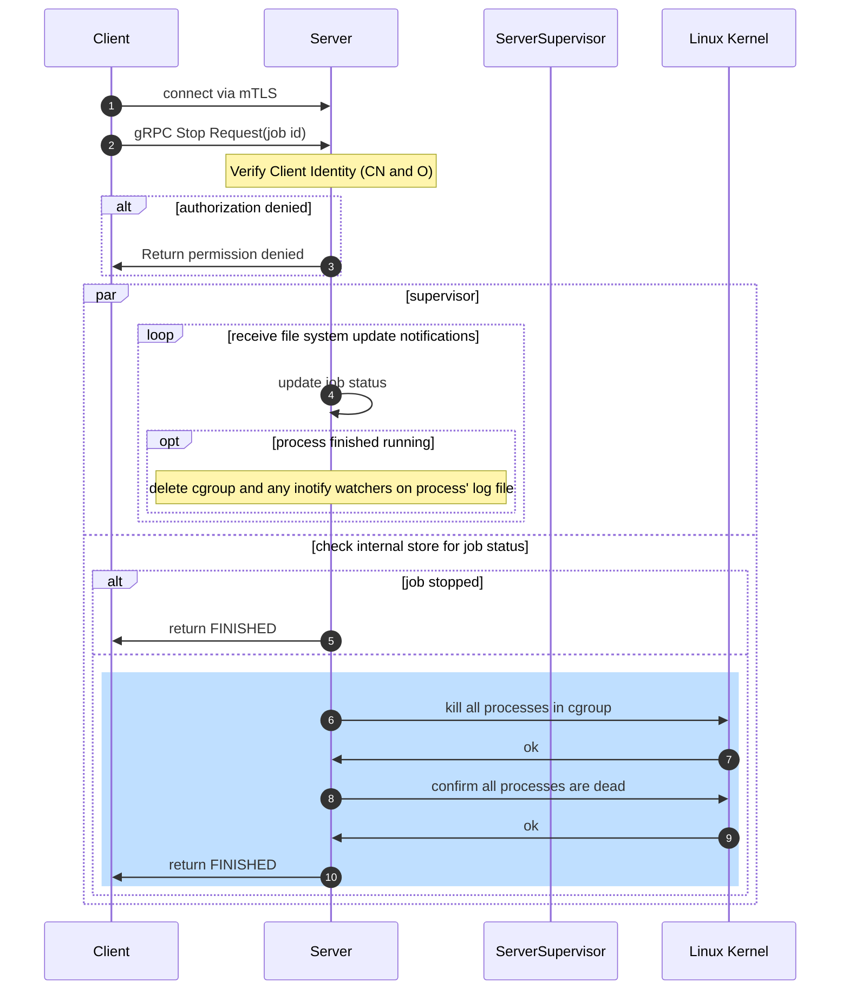
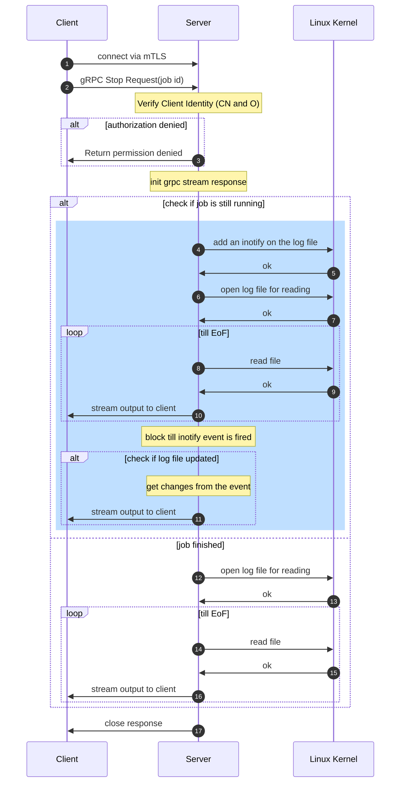

# Remote Code Execution (rce)

```text
    Start date: 2026-05-28              Author: @krish7919
    Status: proposed                    Approvers: strideynet,timothyb89,espadolini
    Type: technical
```

## Context and scope

Implement a prototype job worker service that provides an API to run arbitrary
Linux processes. These processes can be any executable program that is available
on the machine running the service.

Constraints:

- CLI user experience
- TLS setup (version, cipher suites, etc.)
- Output streaming to stream command output to client
- Process execution lifecycle (how will you start and stop jobs, add them to
  cgroups, etc.)

Notes:

- Assume infinite memory
- Clients will specify absolute paths of the executable to the server
- Clients/users can be of 2 types - privileged and non-privileged
    - Create a simple authorization scheme to run commands
    - Restrict authz to gRPC API calls
    - Throw privilege errors if the authz is incorrect
- Create one cgroup per job, no need for namespaces.
- Do not consider scale for now; ignore backpressure, queuing requirements and
  distributed deployment. Assume working with a single binary on a single
  machine
- Do not use a library for cgroup; manipulate cgroups directly in Linux
- Status and output of a job should be available after the job completes
- No retries for failed jobs - focus on bubbling the error/exit code to the
  client
- Reasonable number of clients to expect is 4-6, although one poorly performing
  client should not affect other clients
- No job completion notification required
- Jobs are relatively long lived
- Output streaming should work for such relatively long lived job.
- Use sane defaults for cpu, memory, pid, and io, and ignore hugetlb, cpuset and rdma
- Use of Linux namespaces is out of scope for now (which would solve a lot of our
  security concerns below)
- Do not sanitize the command supplied by the user; that is, allow any
  executable in the `PATH` to access the full filesystem, run `sudo`, `cgroup`,
  `systemd` commands as securing it is out of scope for now
- Assume that resources to run the client-submitted command is available in the
  system; that is, do not check for available CPU/memory or other resource
  before running the command as it is out of scope for now
- Allow client-submitted command to run forever; that is, do not enforce a hard
  timeout on the duration of the commands
- Observability and tracing are not in scope
- Assume that this workflow will be run on Linux (which has cgroups v2 support)
  and the Linux kernel will use the Completely Fair Scheduler (CFS)
  scheduler for resource allocation, tracking and applying quotas.

## Proposal

### Security considerations

Since we would be running any executable on the local machine, we should be very
careful on what to (and what not to run) on the system.

1. The executable should already be in the `$PATH` variable.
2. Ensure that sanity checks are done so that a DoS attack is not possible. For
   example, `tail -F /dev/null`, `setgid`, `cat /etc/passwd`, cgroup or such
   commands are to be avoided. As a thumb rule, client supplied commands should
   not access such files/filesystem paths.
3. Since adding to a cgroup involves spawning the process first and then moving
   it to a cgroup, we need a mechanism that creates a cgroup with sane defaults,
   and then calls the binary in the cgroup.
4. Ensure that the submitted command cannot spawn any other process; this can be
   controlled by writing `1` to the `pids.max` file for the corresponding job
   cgroup so that no other processes can be spawned. *Note:* An `exec` command
   that replaces the current process will be allowed under such circumstances.
   For example, if a client submits `{command=exec, arg=ls}` then we would still
   start a single process with `exec` which would then be replaced by `ls`.

### API design

#### Glossary

1. `job identifier`: This refers to the unique job identifier returned to the
   client by the server. It is of the format
   `rce-<utc_time_in_nanoseconds>-<random_8_alphanum_chars>`; the
   `utc_time_in_nanoseconds` will be identical to the output of `date
   +%Y%m%d%H%M%S-%N` command. For example,
   `rce-20260601220047982614301-abcdef12`.
2. `job status`: This refers to the status of a submitted job, which will be one
   of `[UNSPECIFIED|RUNNING|FAILED|FINISHED]`.


#### Start/run a job

A request to run an executable should contain the following information:

1. Executable to run - only accept the command's absolute or relative paths are
   invalid
2. Arguments to the executable as optional array of strings

A response returned from the server should contain the following information:

1. The unique job identifier
2. The status of the job - `RUNNING` if started the job successfully or `FAILED`
   if the job failed to start
3. An optional error code if the status is failed which is the exit code of the
   command

#### Stop a job

A request to stop a running job should contain the following information:

1. The unique job identifier

A response should contain:

1. The status of the job - `FINISHED` if stopped successfully or `FAILED` if
   could not stop the job

#### Query the status of a job

A request to query a running job should contain the following information:

1. The unique job identifier

A response should contain:

1. The status of the job - `RUNNING` if it is still running, `FINISHED` if
   finished successfully and `FAILED` if it has failed.
2. An optional error code if the status is failed which is the exit code of the
   command

#### Output streaming

A request to query a running/finished job output should contain the following
information:

1. The unique job identifier

A response would be a stream of output if the job is running or the complete
output if the job is finished. Note that the onus is on the client to handle
text vs binary data, the server only sends a byte stream.

Since identifying CLI/executable output is out of scope, we are not going to
define custom response types for text vs binary output; everything will be
streamed as bytes.

#### API Authorization

We will leverage the TLS certificates for authorization at the API level. The
Distinguished Name in a certificate contains many fields, and we will leverage 2
of them - CN (common name) and O (organization).

1. Each certificate has a unique CN and assigned to each client.
2. Each certificate has the O set to the authorization level that is allowed for
   that client.

For the purposes of this exercise, these would be:

1. **ALLOW** (can run any command), along with a static config for allocation
   of CPU, memory, IO and PIDs allowed in the cgroup. An example of how a
   certificate for an allowed client would look like is:

   ```console
   $ openssl x509 -text -noout -in shared/generated/certs/client-allowed.crt 
   Certificate:
      Data:
         Version: 3 (0x2)
         Serial Number:
               47:15:cc:69:d8:f9:70:e9:09:d1:a5:d8:5b:88:1a:fc:e8:2c:8a:df
         Signature Algorithm: ED25519
         Issuer: CN=RCE CA, O=RCE ORG, C=UK
         Validity
               Not Before: Jun  1 22:08:30 2026 GMT
               Not After : Jun 15 22:08:30 2026 GMT
         Subject: CN=client 1, O=RCE Allowed Client, C=UK             <============= note `Organization` here
         Subject Public Key Info:
               Public Key Algorithm: ED25519
                  ED25519 Public-Key:
                  pub:
                     1f:84:5a:ec:83:95:94:c8:73:b3:8f:71:b7:80:41:
                     5c:27:4c:5d:7e:9d:ce:c2:46:0e:db:f0:ad:14:d7:
                     ac:35
         X509v3 extensions:
               X509v3 Subject Key Identifier: 
                  DA:BD:10:F0:80:F1:FD:9A:14:0F:1F:CF:03:AF:3B:3A:AA:86:02:87
               X509v3 Authority Key Identifier: 
                  3C:05:39:80:B4:40:A0:2D:1C:C0:35:1D:09:BB:F3:A6:BA:1F:AF:9D
      Signature Algorithm: ED25519
      Signature Value:
         57:5f:0b:ac:c1:56:3d:0a:f7:01:8c:29:ce:7f:05:07:c8:9e:
         c4:18:33:19:55:bd:4c:c4:05:21:04:b8:22:6e:57:b9:0d:c1:
         36:8b:68:cf:e3:26:47:31:d0:d5:de:53:fd:78:4e:19:d3:bf:
         8e:fb:28:78:39:0a:1b:e6:e4:00
   ```

2. **RESTRICTED** (can only run a subset of commands), along with a hardcoded config
   for allocation of CPU, memory, IO and PIDs allowed in the cgroup; this client
   gets a lessser allocation of resources.  An example of how a certificate for
   a restricted client would look like is:

   ```console
   $ openssl x509 -text -noout -in shared/generated/certs/client-restricted.crt 
   Certificate:
      Data:
         Version: 3 (0x2)
         Serial Number:
               47:15:cc:69:d8:f9:70:e9:09:d1:a5:d8:5b:88:1a:fc:e8:2c:8a:e0
         Signature Algorithm: ED25519
         Issuer: CN=RCE CA, O=RCE ORG, C=UK
         Validity
               Not Before: Jun  1 22:08:30 2026 GMT
               Not After : Jun 15 22:08:30 2026 GMT
         Subject: CN=client 2, O=RCE Restricted Client, C=UK             <============= note `Organization` here
         Subject Public Key Info:
               Public Key Algorithm: ED25519
                  ED25519 Public-Key:
                  pub:
                     3b:af:19:a6:e1:10:a1:62:83:73:73:b1:05:2f:22:
                     56:08:61:db:c1:a1:a3:fc:28:4b:d2:75:ea:fe:51:
                     7a:dc
         X509v3 extensions:
               X509v3 Subject Key Identifier: 
                  C1:27:02:6F:91:52:32:D4:FC:DB:B3:AF:02:F0:80:3E:90:E1:C1:44
               X509v3 Authority Key Identifier: 
                  3C:05:39:80:B4:40:A0:2D:1C:C0:35:1D:09:BB:F3:A6:BA:1F:AF:9D
      Signature Algorithm: ED25519
      Signature Value:
         a5:c2:48:02:43:8b:93:65:1c:05:21:15:8a:21:4d:64:5e:59:
         a5:1e:8b:21:64:42:f9:4b:76:c7:c9:75:ef:37:0e:ef:5e:9c:
         a5:dc:13:40:3e:36:0c:15:bf:4f:73:f8:8f:b6:46:6c:de:cb:
         ba:24:e3:37:19:4e:ee:29:6c:01
   ```

Before running the job, and while in the API handler, a sanity check would be
performed to see if the client is allowed to run a command. A permission denied
error is returned otherwise. Only the job owner/client who has started a job can
stop the job.

If multiple clients want to access the output log of a job, then we
allow/disallow the client if they are in the same group (that is, `Organization`
field set in the certificate `Subject`). For example, the logs of a job started
by `restricted` `client 1` can only be streamed to another `restricted` `client
3`, and not to an `allowed` `client 2` as per the example certificates above.
However, since we do not want to issue multiple `restricted` client
certificates, we would reuse the _same certificate_ that started the job. The
cleaner option would be implementing a better authorization scheme where we can
set output accessibility, however, that is out of scope for now. To be clear, if
a job is started by a `client 2` (as shown above), then we need to start a
client with the same certificate to stream the logs. *Note*: it would be trivial
to issue more client certificates with the appropriate `Subject` set if this is
not acceptable.

More specifically, TLS 1.3 would be used with the default
`TLS_AES_256_GCM_SHA384` cipher suite, which can be set using the
`crypto.tls.Config` option in Go like so:

```golang
   cer, err := tls.LoadX509KeyPair("server.crt", "server.key")
   if err != nil {
      log.Println(err)
      return
   }

   config := &tls.Config{Certificates: []tls.Certificate{cer}}
   ln, err := tls.Listen("tcp", ":443", config) 
   if err != nil {
      log.Println(err)
      return
   }
   defer ln.Close()
```

### CLI UX

We would leverage the Cobra CLI library to create our cli applications, and
examples should look like:

#### Server

```console
$ ./remote-code-execution server <port> <path to server TLS cert>
```

For executing the client-submitted command that would be started by the server,
the CLI format would run the same binary but with a different sub-command:

```console
$ ./remote-code-execution worker <cgroup path> <cpu limit> <memory limit> <io limit> <command> [<args...>]
```

#### Client

```console
$ ./remote-code-execution-client <start|stop|status|output> <server host:port> <path to client TLS cert> <command> [<args...>]
```

## Implementaion details

1. The state of the system will be stored in memory (assuming memory is infinite
   helps here), and there are no dependencies on external storage systems which
   keeps the scope tight. Since this will be a stateless system, when the server
   goes down, we will lose state of the jobs stored in memory and will have no
   way to track it.

2. On a (re)start of the server, query the server cgroup and delete all the
   child cgroups that were previously started but aren't being tracked, so that
   we do not have hanging jobs from a previous run; this would be easier to do
   if we use cgroups v2 as it supports a unified hierarchy. Refer the the first
   statement under section `CGROUPS VERSION 2` in `man cgroups`:
   
   ```text
   In cgroups v2, all mounted controllers reside in a single unified hierarchy.
   ```

   In cgroups v2, it is as simple as writing `1` to the
   `/sys/fs/rce/cgroup.kill` file, and then polling the `cgroup.events` file to
   check if the `populated` value is `0`, which shows that there are no
   processes running in the cgroup hierarchy created by the server process.

3. On startup, start a background process that creates a filesystem watcher
   using `fanotify` syscall. This will enable us to watch all filesystem changes
   over `/sys/fs/cgroups/rce`, and receive events for changes. Then we can
   filter for changes to all the `cgroup.events` files and check that the
   `populated` values is `0`. If so, we update the in memory data model to
   update a jobs status as finished; we query the job using the cgroup name,
   which is identical to the job identifier.

   - https://github.com/slimtoolkit/slim/blob/master/pkg/third_party/madmo/fanotify/fanotify.go
     provides a Golang wrapper to use the Linux syscall `fanotify`; an example
     usage is in
     https://github.com/slimtoolkit/slim/blob/master/pkg/app/sensor/monitor/fanotify/monitor.go
   - once the number of running processes is `0`, delete the cgroup
   - mark the status of the job as `FINISHED` accordingly

3. All the cgroups created by the server will be under a single root
   `/sys/fs/cgroup/rce/<job identifier>`; this would also be easier to do if we
   use cgroups v2.

3. Since a client can submit a `sudo` or privileged command, we must ensure that
   the spawned process from the server does _not_ run as root or any specific
   user. Creating namespaces or creating a dedicated user for spawning a process
   or for running the server is out of scope for now.

4. Every request to stream output of a job should have the job identifier
   specified, and we should not serve another jobs' logs to a different client.

5. The server will call a separate `worker` binary which executes the executable
   with its args _after_ spawning the `worker` process. This is done so that we
   can enforce that the process is first created, then moved to the cgroup and
   only after this step is the client submitted command allowed to run. For
   example, `runc` and other solutions in the field call their own binary with
   an internal flag to do this, and we will use a subcommand in its place.
   Before starting the binary with the `worker` subcommand (see point 5 above),
   the server will:

   - create the cgroup with the correct limits for the worker to be run
   - create and open the log file, and pass the log file handler to the worker
     process as its `stderr` and `stdout` file handler
   - create a pipe and pass it on the the worker for IPC; this pipe will be used
     by the worker to signal to the server that the executable has started
     successfully or failed, so that the server can send a response to the
     client; the server will close the write end of the pipe
   - pass on the executable and arguments submitted by the client to the worker
     and start the worker
   
   The worker will:

   - query its own PID and write it to the `sys/fs/cgroup/rce/>job
     identifier>/cgroup.procs` file
   - open the pipe for writing, and once the process has moved into the cgroup,
     close the pipe to notify the server that the setup is done and the
     executable will be executed; in case of error, write an error code to the
     pipe and exit
   - exec the client executable to replace the current process

   Since the output from the worker process would be written to a file, when a
   client requests for the output log, the server can perform read of
   the file on disk and stream the data to the client. After reaching eof (`err == io.EOF`), set up an `inotify` watcher on the log file
   the server can check the status of the job, and when the job is in `FINISHED` state. Also, as the output can be text or binary, send the output message as `base64` string to the client, where the client can decode it on the console (or store it to a file) accordingly.

6. `cpu.max` file has the format `max period` where `max` is the maximum CPU
   time in microseconds consumed in a period `period`. For restricted clients,
   this will be set to 10% core every 100ms as `10000 100000` and for allowed
   clients, this will be set to 40% core every 100ms as `40000 100000`. A 100ms
   period is a good default value to avoid thrashing or context-switching
   overhead in the kernel. For example,

   ```golang
   limit := []byte("150000 100000")
   // note that the `0644` is effectively useless as we are not creating the
   // file or changing the file's existing permissions.
   err := os.WriteFile("/sys/fs/cgroup/rce/<job-identifier>/cpu.max", limit, 0644)
   ```

7. `pids.max` file has the format `max` where `max` is the number (integer) of
   concurrent tasks that can be created by processes in the current cgroup. For
   restricted clients, this will be set to `100` and for allowed clients, this
   will be set to `400`. The `pids.events` file contains a counter that shows
   how many times a clone/fork fails because the `pids.max` limit was hit, which
   is useful for debugging jobs in a cgroup that cannot start new process. Using
   the `pids.events` is out of scope for now.

8. `memory.max` file has format `max` where `max` is the number of bytes of
   memory allowed for the cgroup before being `OOMKilled`. For restricted
   clients, this will be set to `104857600` for 100MB, and for allowed clients
   this will be set to `524288000` for 500MB. Note that usage of the
   `memory.high` file, which acts as a soft limit and tries to reclaim memory
   before hitting the `max` value, and the `memory.events` file, which tracks
   the memory metrics of a cgroup, are out of scope for now.

   ```golang
   limit int64 := 104857600
   err := os.WriteFile("/sys/fs/cgroup/rce/<job-identifier>/memory.max",[]byte(strconv.FormatInt(limit, 10)), 0644)
   ```

9. `io.max` file has to format `major-device:minor-device rbps=max wbps=max
   riops=max wiops=max` where `max` is the rate, either bytes per second
   (integer) or io operations per second (integer) at which data can be read or
   written to a device. Since a system where the server is run can contain
   multiple disks, and the client can submit a command to write to disk (with
   output redirection) or read from disk (with input redirection), we will have
   to parse each argument supplied to the executable and find the files' device
   major or minor version and set sane defaults accordingly. This would increase
   the scope for now, and we will assume that the server is being run on a
   system with a single device. For restricted clients, the bytes per second
   will be set to `10485760` (10MBps) and the io operations per second will be
   set to `200`. For allowed clients, these will be `524288000` (500MBps) and
   `500` respectively.

## Proposed workflow

### Server startup



### Start a job



### Query status of a job



### Stop a job



### Stream output



### Alternatives to proposal

1. Using non-cgroups based workflow by leveraging micro VMs like firecracker,
   etc. is out of scope.
2. Using containers as an alternative to cgroups is out of this scope.

## Risks

1. Add itempotency for handling requests from the client so that we do not
   accidentally start multiple jobs due to network issues.

## Execution plan

1. Add timelines, estimates/cost, etc here.